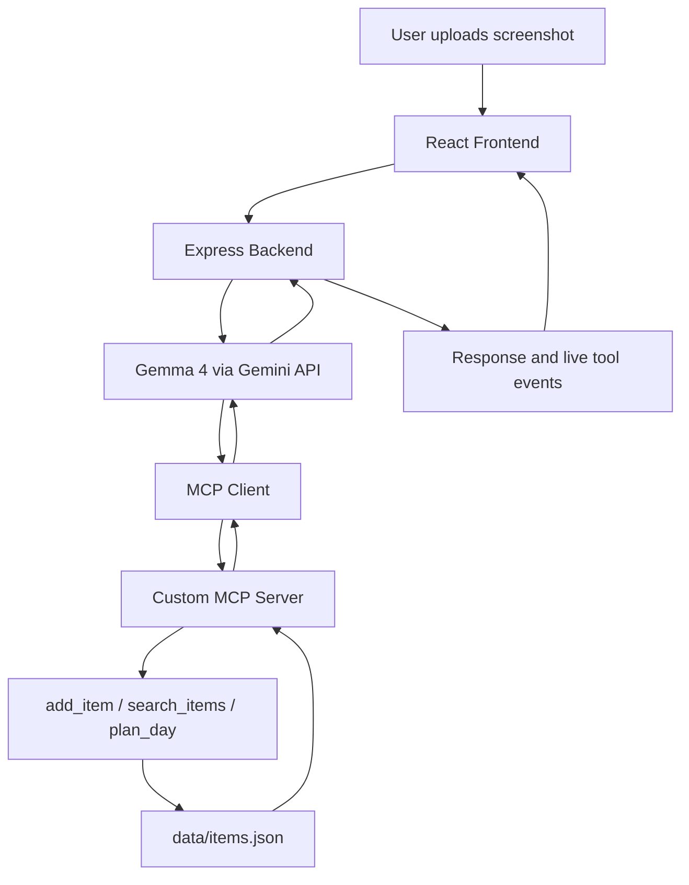

# Mem<3ry

<div align="center">

### Your saved reels, finally remembered.

Turn screenshots of useful reels into searchable memories and actionable plans.

[](LICENSE)
[](https://nodejs.org/)
[](https://ai.google.dev/gemma)
[](https://modelcontextprotocol.io/)

[Features](#features) · [Architecture](#architecture) · [Getting Started](#getting-started) · [Contributing](#contributing) · [License](#license)

</div>

---

## What is Mem<3ry?

Useful information gets buried in saved reels. You might save a café recommendation, a workout routine, a recipe, or a travel destination, only to struggle to find it later.

**Mem<3ry turns screenshots of reels into structured, searchable memories.**

Upload a screenshot, let Gemma 4 extract its useful information, and retrieve it later using natural language in English or Tanglish. You can also generate a simple plan from the items you have saved.

## Features

- **Screenshot to Memory:** Extracts titles, categories, places, areas, key points, and tags from screenshots.
- **Natural Language Search:** Find relevant saved items using English or Tanglish queries.
- **Weekend Planner:** Organizes saved items into a simple, timed plan.
- **MCP Tool Integration:** Connects the AI agent to tools for adding, searching, and planning.
- **Live Tool Feed:** Streams tool execution status, duration, and summaries to the interface.
- **Responsive Interface:** A React-based interface designed to work across screen sizes.
- **Local JSON Storage:** Stores saved memory records in `data/items.json`.

## How It Works



### Technology Stack

| Component | Technology |
|---|---|
| Frontend | React, Vite, JavaScript |
| Backend | Node.js, Express |
| AI model | Gemma 4 through the Gemini API |
| AI SDK | `@google/genai` |
| Tool integration | Model Context Protocol (MCP) |
| Input validation | Zod |
| Storage | JSON file |
| Live updates | Server-Sent Events (SSE) |

### MCP Tools

| Tool | Purpose |
|---|---|
| `add_item` | Extracts information from a screenshot or caption and saves a memory. |
| `search_items` | Searches saved memories using relevant keywords, categories, and areas. |
| `plan_day` | Creates a timed plan using eligible saved items. |

The model interprets user requests and selects tools when needed. The MCP server performs the corresponding operations, while the live tool feed exposes execution progress to the user.

## Getting Started

### Prerequisites

- [Node.js](https://nodejs.org/) 20 or newer
- npm
- A Gemini API key with access to the configured model

### 1. Clone the repository

```bash
git clone https://github.com/Dev-GA-Arjun/Mem-3ry.git
cd Mem-3ry
```

### 2. Install backend dependencies

```bash
npm install
```

### 3. Configure environment variables

Create a `.env` file in the repository root.

**Windows PowerShell**

```powershell
Copy-Item .env.example .env
```

Open `.env` and configure your values:

```dotenv
GEMINI_API_KEY=your_gemini_api_key
GEMMA_MODEL=your_supported_gemma_model_id
PORT=3000
```

Use the model ID supported by your Gemini API account. Keep your API key private and never expose it in frontend code or commit your `.env` file.

### 4. Start the backend

From the repository root:

```bash
node --env-file=.env server/index.js
```

### 5. Start the frontend

Open a second terminal:

```bash
cd web
npm install
npm run dev
```

Open the local URL printed by Vite, usually:

```text
http://localhost:5173
```

The frontend development server proxies API requests to the backend.

## API Endpoints

| Method | Endpoint | Description |
|---|---|---|
| `POST` | `/api/upload` | Upload a screenshot for extraction and storage. |
| `GET` | `/api/items` | Retrieve saved memory items. |
| `POST` | `/api/chat` | Send a natural-language query to the AI agent. |
| `GET` | `/api/events` | Receive live tool execution events through SSE. |

For implementation details, see [`docs/ARCHITECTURE.md`](docs/ARCHITECTURE.md).

## Running Tests

Run the available upload and planner tests from the repository root:

```bash
node --test server/test-upload.js server/test-plan.js
```

These tests cover upload and planning behavior. External AI service availability may affect live model requests.

## Project Structure

```text
Mem-3ry/
├── mcp/
│   ├── server.js
│   └── item-service.js
├── server/
│   ├── index.js
│   └── agent.js
├── web/
│   ├── src/
│   └── package.json
├── data/
│   └── items.json
├── docs/
│   └── ARCHITECTURE.md
├── .env.example
├── LICENSE
└── README.md
```

## Open Source

Mem<3ry is released under the **MIT License**. You are welcome to explore the source, report issues, suggest improvements, and submit contributions.

### Contributing

Contributions are welcome.

1. Fork the repository.
2. Create a branch for your change.
3. Make your changes and run the relevant tests.
4. Commit your work with a descriptive message.
5. Open a pull request explaining the problem and your solution.

For bugs or feature ideas, open an issue with enough detail to reproduce the problem or understand the proposed change.

Please do not include API keys, personal data, or private screenshots in issues or pull requests.

## Roadmap

Potential areas for future contributions:

- More robust search and ranking.
- Additional storage backends.
- Better handling of model API failures.
- Improved memory editing and organization.
- More automated tests and continuous integration.

These are possible future improvements, not claims about existing functionality.

## License

Distributed under the [MIT License](LICENSE).

---

<div align="center">

**Mem<3ry** · Built for otaku.dev'26, Hacktoberfest Hack Day by Commit Culture, Chennai.

[Report a Bug](https://github.com/Dev-GA-Arjun/Mem-3ry/issues) · [Request a Feature](https://github.com/Dev-GA-Arjun/Mem-3ry/issues)

</div>
